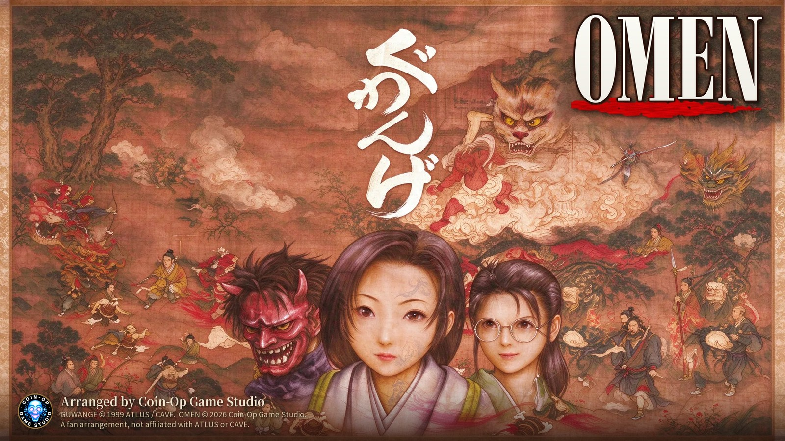

# Guwange: Omen — N64 · PS Vita · Arcade

<p align="center">
  
</p>

**Guwange: Omen** is an arrangement of Cave's 1999 arcade shooter *Guwange* by **Coin-Op Game Studio**, with a
designed crimson palette, reworked skull-meter rules with the OMEN X2 mode, and a hitbox marker. This repository holds the **player's kit**, which
builds the game for three systems from **your own copy of the arcade ROMs**:

| System | You get | Runs on |
|---|---|---|
| **Nintendo 64** | `guwange_omen.z64` | a flash cart (EverDrive 64 X7, SummerCart64, 64drive) with the 8 MB **Expansion Pak** |
| **PS Vita** | `guwange_omen.vpk` | a Vita running HENkaku / Enso, installed with VitaShell |
| **Arcade** | `guwangeo.zip` | MAME, or a real Guwange Blue Label board with four ROM chips replaced |

The N64 and Vita versions include all three modes: the **original Guwange** (1999), the **Special / Blue Label**
version (2000) and **Omen**. They run the arcade program itself, translated for the console, on a model of the arcade
board.

**This repository contains no game data.** The kit's files are encrypted with a key computed from the arcade ROM
images: they open only with correct dumps, and the game's graphics, sound and program are decoded from your own files.
Nothing is downloaded.

## What's here

| Folder | Contents |
|---|---|
| [`Guwange_Omen_Kit/`](Guwange_Omen_Kit) | the builder kit: `guwange-kit` for Windows, Linux and macOS, the sealed packages (`kit/`), the arcade IPS patches (`arcade/`) and the kit's own [`README.txt`](Guwange_Omen_Kit/README.txt) |
| [`n64/`](n64) | the N64 **instruction booklet** (English and Japanese, plus print-ready sheets) and the **cartridge label and box art** for making a physical copy. See [`n64/README.md`](n64/README.md) |
| [`images/`](images) | previews used on this page |

## Quick start

### 1. Get the ROMs

You need MAME's Guwange sets (MAME 0.287 names): **`guwange`** (the original) and **`guwanges`** (the Special
version). Any of these work:

- one merged `guwange.zip` that holds both,
- split sets: `guwange.zip` + `guwanges.zip`,
- loose files in a folder.

File names don't matter. Every file is found by its size and CRC32, then checked against its SHA-1. These are the
thirteen files the kit looks for:

```
gu-u0127.bin   gu-u0129.bin              guwange  -- the original's program
gu-u0127b.bin  gu-u0129b.bin             guwanges -- the Special version's program
u083.bin u082.bin u086.bin u085.bin      sprites
u101.bin u10102.bin u10103.bin           backgrounds
u0462.bin                                sound samples
eeprom-guwange.bin                       default settings
```

### 2. Run the kit

**Windows:** put your ROM zips in `Guwange_Omen_Kit/roms/` and double-click `guwange-kit.exe`. You can also drag the
zips onto `guwange-kit.exe`.

**Linux / macOS:** open a terminal in `Guwange_Omen_Kit/` and run the program for your system:

```bash
chmod +x guwange-kit-linux            # once, if your download lost the executable bit
./guwange-kit-linux
```

On macOS, use `guwange-kit-macos-arm64` (Apple silicon) or `guwange-kit-macos-intel` (Intel). If macOS refuses to
open a program from the internet, right-click it, choose **Open**, then **Open** again.

**More options** (the same on every system):

```
guwange-kit                                     everything, ROMs from the roms folder
guwange-kit n64                                 the N64 only
guwange-kit vita                                the Vita only
guwange-kit arcade                              the arcade set only
guwange-kit --roms D:\mame\roms                 ROMs from another folder
guwange-kit path\to\guwange.zip --out D:\out    ROMs named directly, another output folder
guwange-kit --check                             only check the ROM sets
```

The results go to `Guwange_Omen_Kit/output/`, in `n64/`, `vita/`, `arcade/` and `manual/` (the instruction booklets
for both consoles). The kit checks each package before it writes it.

### 3. Install

**Nintendo 64.** Copy `output/n64/guwange_omen.z64` to your flash cart's SD card. The console needs the
**Expansion Pak**. The save type is **EEPROM 16K**: the ROM's header says so, but if your cart's menu asks, or saves
don't stick, choose EEPROM 16K by hand.

**PS Vita.** Copy `output/vita/guwange_omen.vpk` to the Vita and install it with **VitaShell**.

**Arcade.** `output/arcade/guwangeo.zip` holds Omen's four ROM files: the Special (Blue Label) set's two program
ROMs and two sprite ROMs, with the patches applied.

| File | Chip | Board location |
|---|---|---|
| `gu-u0127b.bin` | program, 4 Mbit | U0127 |
| `gu-u0129b.bin` | program, 4 Mbit | U0129 |
| `u085.bin` | sprites, 32 Mbit | U085 |
| `u086.bin` | sprites, 32 Mbit | U086 |

- **MAME:** MAME looks for a set by its name, so copy `guwangeo.zip` as `guwanges.zip` into a folder of its own,
  for example `omen` next to MAME's `roms` folder, which keeps your untouched `guwange.zip`. Then run:

  ```
  mame guwanges -rompath "omen;roms"
  ```

  MAME warns about four wrong checksums; that's expected.
- **The real board:** burn the four files to four ROM chips and replace the chips at those four locations on a
  Guwange Blue Label board with them.

To patch the Blue Label files by hand instead, use the four IPS patches in `Guwange_Omen_Kit/arcade/` (notes in its
`README.txt`).

## Controls

| | Nintendo 64 | PS Vita |
|---|---|---|
| Move | control stick or D-pad | left stick or D-pad |
| Shot (hold for the shikigami) | A | Cross |
| Bomb | B | Circle |
| Button 3 | Z | Square |
| Autofire shot | C-down (when AUTOFIRE is on) | Triangle |
| Start / continue | START | Start |
| Host menu | L + R together | L + R together, or Select |

There are no coins: the game always runs in the board's own free play. The host menu sets the mode (Original /
Special / Omen), the screen layout (the N64 supports a TV turned on its side, **TATE**, or an upright one, **YOKO**),
speed, volume, autofire, continues and the board's TEST MODE. The Vita adds practice mode, hitbox display and gadget
columns beside the game. The full guide is in each system's instruction booklet.

## Troubleshooting

The kit lists any problem with your ROMs:

- **MISSING**: that file wasn't in what you gave the kit. The list shows each file's size, CRC32 and set. Most often
  it's one of the two program files from the `guwanges` (Special) set.
- **BAD**: a file with that name is not the right dump (from an older MAME set, or a patched or damaged file). Get a
  good dump of it.

On the N64, **EXPANSION PAK REQUIRED** means the console has no Expansion Pak fitted.

## Making a physical N64 copy

[`n64/`](n64) has everything to print: the 117 × 173 mm instruction booklet, the die-cut cartridge label and the
NTSC-U style box. [`n64/README.md`](n64/README.md) covers what cartridge to order (512 Mbit, EEPROM 16K, CIC 6102 /
7101) and how to print each piece.

<p align="center">
  
</p>

## Legal

The kit holds no data from the arcade ROMs. The packages you make from it **do** hold data from your ROM images:
they are for your own use, not for distribution. Please don't share the `.z64`, `.vpk` or `guwangeo.zip` you make.

*Guwange* is © 1999 CAVE / ATLUS. *Guwange: Omen* is a fan arrangement by Coin-Op Game Studio and is not affiliated
with or endorsed by CAVE, ATLUS, Nintendo or Sony. Nintendo 64 and PS Vita are trademarks of their respective owners.
